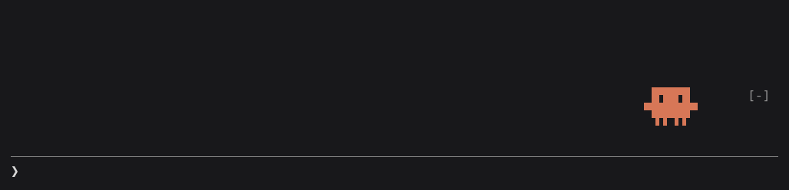
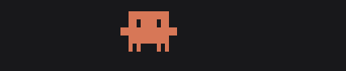
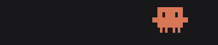
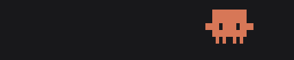
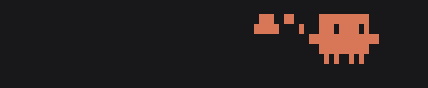
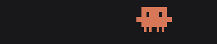
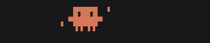
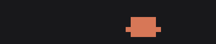

# mascot

A little animated Claude critter for [Claude Code](https://claude.com/claude-code). It lives in the row above your prompt and reacts to what's happening in the session.



## What it does

The critter from the Claude Code welcome logo, one cell narrower, sits at the right edge above the prompt in your theme's Claude color. Each state has a few animations; the mascot picks one at random each time it gets there, and switches to another every 12 seconds while a state lasts:

| | |
| --- | --- |
|  | **Idle**: strolls somewhere new every few seconds while blinking, looking around, or waving |
|  | **You start writing**: for the first 3 seconds bounces, tap-dances, or cheers |
|  | **You keep writing**: stands looking down at the prompt, reading along or nodding, until you send or clear it |
|  | **Claude is deep in thought** (extended thinking): sits down and grows a thought cloud over its head, follows a spark of an idea, or scratches its head |
|  | **Claude is working** (writing its reply, calling tools, waiting on them or on subagents): scuttles back and forth, hops along, or hammers away on the spot |
|  | **The turn is done**: bounces, throws its arms up, or jumps for joy, with sparkles |
|  | **Nothing for 2 minutes**: lies down and falls asleep, breathing slowly, or dozes off on its feet |

It also shakes, or flinches and shivers, with its eyes squeezed shut when a turn is interrupted or a tool fails.

The mascot shows in the terminal and in the desktop app; VS Code and mobile don't draw the row above the prompt.

## Install

In a Claude Code terminal session:

```
/plugin install mascot --marketplace RosaliePerron/mascot
```

Answer `y` to add the marketplace, then press Enter to install it for your user. The mascot appears right away and in every session after.

### From a clone

```sh
git clone https://github.com/RosaliePerron/mascot.git ~/projects/mascot
```

Load it for one session with `claude --plugin-dir ~/projects/mascot`, or for every session by adding it to `~/.claude/settings.json`:

```json
{
  "env": { "CLAUDE_CODE_PLUGIN_DIRS": "~/projects/mascot" }
}
```

Loaded this way, edits to the folder reload in interactive sessions as you save.

## Development

```sh
claude plugin validate .   # manifest, marketplace and hooks
claude plugin test .       # hooks/register.test.tsx
tsc -p .                   # type-check
```

`tsconfig.json` extends `.claude-plugin/types/tsconfig.json`, which Claude Code writes the first time it loads the mod, so load it once before type-checking.

| File | What it holds |
| --- | --- |
| `hooks/register.tsx` | The hooks: follows typing, turns and tool calls, keeps the mascot's mood in plugin state, and draws the band above the prompt |
| `hooks/critter.tsx` | The animation: a small pixel canvas drawn with quadrant block characters, stepped every 100 ms on the surface's frame clock |
| `types/index.d.ts` | The mood's type contract |

The images in `docs/` were recorded from a real Claude Code session.
