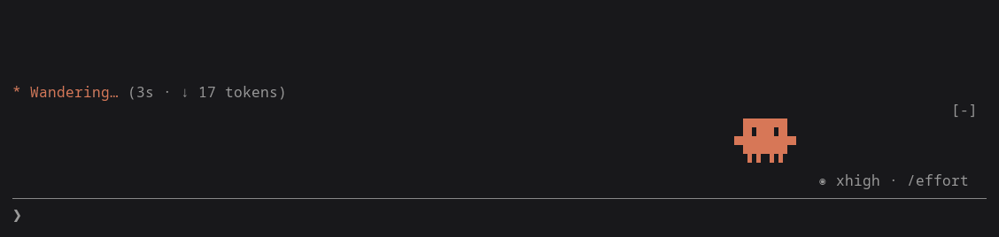

# mascot

A little animated Claude critter for [Claude Code](https://claude.com/claude-code). It lives in the row above your prompt and reacts to what's happening in the session.


## What it does

The critter from the Claude Code welcome logo, one cell narrower, sits at the right edge above the prompt in your theme's Claude color. Each state has a few animations; the mascot picks one at random each time it gets there, and switches to another every 12 seconds while a state lasts:

| | |
| --- | --- |
|  | **Idle**: strolls somewhere new every few seconds while blinking, looking around, or waving |
|  | **You start writing**: for the first 3 seconds bounces, tap-dances, or cheers |
|  | **You keep writing**: stands looking down at the prompt, reading along or nodding, until you send or clear it |
|  | **Claude is deep in thought** (extended thinking): sits down and grows a thought cloud over its head, follows a spark of an idea, or scratches its head |
|  | **Claude is working** (writing its reply, calling tools, waiting on them or on subagents): scuttles back and forth, hops along, or hammers away on the spot |
|  | **The turn is done**: bounces, throws its arms up, or jumps for joy, with sparkles |
|  | **Nothing for 2 minutes**: lies down and falls asleep, breathing slowly, or dozes off on its feet |

It also shakes, or flinches and shivers, with its eyes squeezed shut when a turn is interrupted or a tool fails.

When Claude runs subagents, each one gets a mascot of its own beside the main one, acting out what that subagent is doing with the same animations. It makes an entrance (dropping in, popping up out of the ground, or beaming in) and, once its subagent finishes and it has celebrated, an exit (jumping away, sinking into the ground, or waving goodbye before vanishing in a puff).



Click it and it reacts: it giggles, jumps in surprise, spins around, or plays peekaboo, a different one each click. A click wakes it up too.

The mascot shows in the terminal and in the desktop app; VS Code and mobile don't draw the row above the prompt.

### /dino

Type `/dino` and the mascot runs the dinosaur game across the whole width of the terminal: press space (or `w`) to jump over the cacti and `s` to duck under the birds; they come faster the further it gets; space again after a crash; `q` to quit. While it runs, what you type goes to the game, not the prompt.

## Install

In a Claude Code terminal session:

```
/plugin install mascot --marketplace RosaliePerron/mascot
```

Answer `y` to add the marketplace, then press Enter to install it for your user. The mascot appears right away and in every session after.

### From a clone

```sh
git clone https://github.com/RosaliePerron/mascot.git ~/projects/mascot
```

Load it for one session with `claude --plugin-dir ~/projects/mascot`, or for every session by adding it to `~/.claude/settings.json`:

```json
{
  "env": { "CLAUDE_CODE_PLUGIN_DIRS": "~/projects/mascot" }
}
```

Loaded this way, edits to the folder reload in interactive sessions as you save.

## Settings

**Position**: `left`, `center` or `right` (the default), where the mascot lives in the row above the prompt. Installing asks for it; change it later in `/config`, or in `~/.claude/settings.json`:

```json
{
  "pluginConfigs": { "mascot@mascot": { "options": { "position": "left" } } }
}
```

Loaded from a clone, the key is `mascot` instead of `mascot@mascot`.

## Updating

Claude Code runs the copy it made when you installed the mascot, so a new release arrives when you update it:

```sh
claude plugin marketplace update mascot
claude plugin update mascot@mascot
```

Then restart Claude Code. To get new releases without asking, open `/plugin`, go to the `mascot` marketplace and choose **Enable auto-update**: Claude Code then updates it each time it starts.

If you load the mascot from a clone instead, `git pull` in that folder is the update.

## Development

```sh
claude plugin validate .   # manifest, marketplace and hooks
claude plugin test .       # hooks/register.test.tsx
tsc -p .                   # type-check
```

`tsconfig.json` extends `.claude-plugin/types/tsconfig.json`, which Claude Code writes the first time it loads the mod, so load it once before type-checking.

| File | What it holds |
| --- | --- |
| `hooks/register.tsx` | The hooks: follows typing, turns and tool calls, keeps the mascot's mood in plugin state, and draws the band above the prompt |
| `hooks/critter.tsx` | The animation: a small pixel canvas drawn with quadrant block characters, stepped every 100 ms on the surface's frame clock |
| `types/index.d.ts` | The mood's type contract |

The images in `docs/` were recorded from a real Claude Code session.
